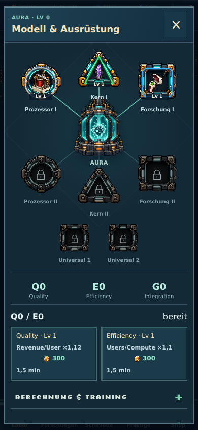
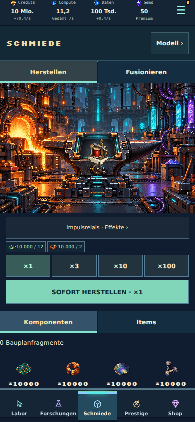
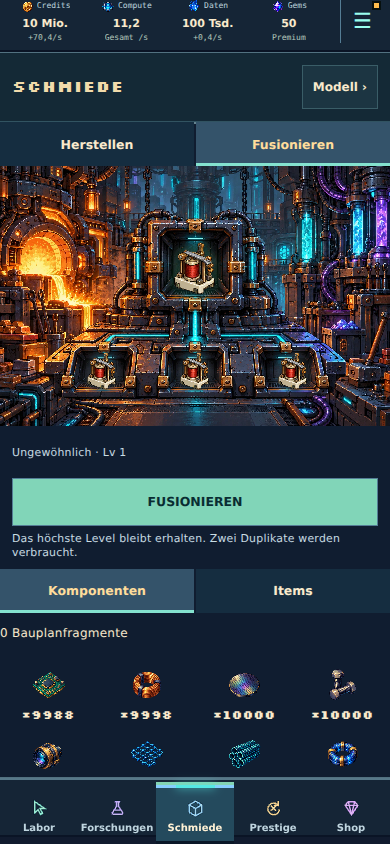
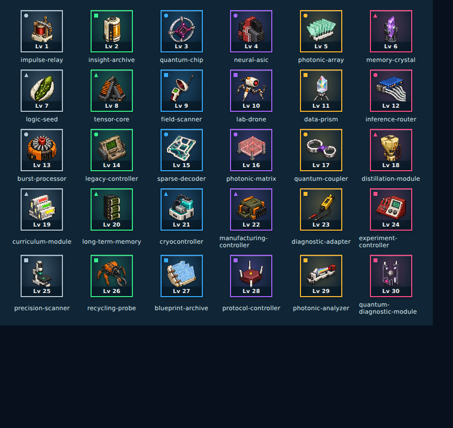

# Bestehende Grafik sauber integrieren · Beta 6

Die Spielbereiche und ihre Navigation bleiben erhalten. Die vorhandenen Item-, Sockel-, KI-Kern- und Schmiedegrafiken werden unverändert weiterverwendet. Der Ausrüstungsbildschirm greift wieder die frühere Darstellung mit KI-Kern und sechs umliegenden Sockeln auf; die zuletzt eingeführte Kartentabelle entfällt. Training und Itemauswahl bleiben im vorhandenen Fenster.

## Behobene Darstellungsursachen

- Der Item-Atlas ist 1374 × 1145 Pixel groß. Seine Motive halten das nominelle 6×5-Raster nicht überall ein. Feste Rasterzellen zeigten deshalb abgeschnittene Gegenstände und teilweise Nachbarfragmente. Alle 30 Gegenstände verwenden nun geprüfte Bildgrenzen und eine eigene Clipkontur. Das Bitmap bleibt identisch; SVG dient ausschließlich als präziser Ausschnitt des bestehenden PNG. Seitenverhältnis und Zentrierung bleiben erhalten.
- Der gemeinsame `ItemPortrait` besitzt einen einzigen Seltenheitsrahmen, integriertes Level und eine kleine Familienmarkierung. Inventar, Shop, Season, Auswahl und Ergebnisanimationen verwenden dieselbe Darstellung. Ein integriertes Häkchen ersetzt das über den Rand ragende Ausgerüstet-Banner; der zugängliche Buttonname enthält den Ausrüstungsstatus.
- Im Ausrüstungssockel steckt direkt das Item, ohne zusätzliche Portraitkarte. Kreis, Dreieck und Quadrat verwenden ihre bestehenden Bitmaprahmen mit passenden Innenflächen. Die ursprüngliche KI-Kerngrafik sitzt mittig; Verbindungen laufen hinter den Sockeln. Universalslots überdecken den Kern nicht.
- In der Schmiede liefern die gemalten Vertiefungen bereits den Rahmen. Dort werden freigestellte Items ohne weiteren Kartenhintergrund dargestellt. Herstellung und Fusion bleiben sofortige Transaktionen mit den bestehenden Animationen.
- Konkurrierende Equipment-Regeln wurden aus den bisherigen CSS-Dateien entfernt. `equipment.css` besitzt die Darstellung des vorhandenen Equipment-Fensters; `item-presentation.css` besitzt die gemeinsame Itemdarstellung. Eine generische Regel, die alle direkten Spans einer Rezeptkachel absolut positionierte, gilt jetzt nur für deren Statusanzeige.
- Bedientexte verwenden dieselbe lesbare Systemschrift. Pixelüberschriften und vorhandene Pixel-Art bleiben erhalten; lange KI-Modellnamen verwenden die Leseschrift.

## Gem-Angebot nach Nutzung ausblenden

Nach erfolgreichem Gem-Abruf verschwindet das kleine Angebot. Erst nach zehn Minuten kann es erneut erscheinen. `commerce.gemNextAt` hält die absolute Frist auch über Reload und Offline-Zeit fest. Das optionale, validierte Feld ist mit vorhandenen v63-Spielständen kompatibel; ältere Spielstände beginnen ohne aktive Frist. Es ist kein Reset nötig.

Abbruch und Fehler starten keine neue Frist und gewähren keine Gems. Bestehende Tageslimits und der Bonus für jeden zehnten erfolgreichen Abruf bleiben wirksam; Werbefrei verwendet dieselbe Frist. Bei ausgeschöpftem Tageslimit bleibt die Karte verborgen. Ohne angeschlossenen Werbeanbieter kann kein echtes Video gestartet werden.

## Abnahme

`scripts/cohesive-item-polish-audit.mjs` bedient die echte App mit einem synthetisch finanzierten Testspielstand. Es rüstet die drei Itemfamilien tatsächlich aus und misst bei 320/390/430 px: Sockel innerhalb der Szene, mindestens 44 px Touchfläche, mittige Gegenstände und keine verschachtelten Portraitrahmen. Es prüft außerdem Sofort-Herstellung/Fusion, Season-Kisten, Seitenüberbreite, reduzierte Bewegung und den gespeicherten Zehn-Minuten-Ablauf. Die Video-Prüfung verwendet eine ausschließlich im Fixture gesetzte Werbefrei-Berechtigung; es wird kein Live-Kauf und kein echtes Werbevideo ausgelöst.

Die Übersicht zeigt alle 30 realen Motive in den gemeinsamen Rahmen. Die Shop-, Forschungs-, Prestige- und Einstellungsansichten wurden zusätzlich auf Seitenüberbreite geprüft. Browserabnahme ersetzt keine Performance-/Touchabnahme in WKWebView auf einem echten iPhone.

Lokale technische Abnahme mit Node 22.23.3: 1.651 Tests in 118 Dateien, Typecheck und Produktionsbuild bestanden. Die bestehende Vite-Warnung zum großen Hauptchunk bleibt; Geräteperformance ist separat abzunehmen.
