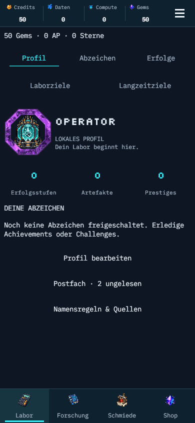

# Außenring als animiertes Energiematerial · 2026-11-04

Der bisherige Linien-/Orbit-Effekt wurde für Portraitrahmen durch einen eigenen prozeduralen Unity-UI-Shader ersetzt. Dunkle violette Nebelstrukturen werden verzerrt und durch helle Energieadern unterbrochen. Eine schmale beleuchtete Kante und ein begrenzter Lichtsaum geben dem Ring Tiefe. Der Look orientiert sich an der gewünschten Dark-Matter-Richtung; es werden keine fremden Texturen oder Spielassets verwendet.

Die Mitte bleibt transparent. Das bisherige Pulsieren und Einfärben des Cores sowie die Farbanimation des Profilnamens sind entfernt. Größe und Layout bleiben erhalten.

Die Demo ist ein Ausschnitt der laufenden Animation, kein vollständiger 24-Sekunden-Loop. Die Shader-Strömung selbst hat einen geschlossenen 24-Sekunden-Zeitpfad. Zeit wird über die Mesh-UVs übergeben, statt einen unabhängig laufenden Shader-Zeitgeber zu verwenden. Damit friert reduzierte Bewegung die gesamte Oberfläche ein. Gemeinsames Material, ein Quad pro Ring, keine Partikel oder neuen Bitmap-Texturen. Bestehende Begrenzung auf 30 Aktualisierungen pro Sekunde und sechs sichtbare Akzente bleibt erhalten. Stencil-Maskierung und Rect-Clipping werden unterstützt; der Ring blockiert keine Touchziele.

## Prüfung

- 6/6 PlayMode-Tests: ReleasePresentationTests und WorkshopTests.
- Tatsächlicher Pixelvergleich zweier gerenderter Frames: mehr als 80 veränderte Außenring-Pixel; kein verändertes Pixel im mittleren 40×40-Bereich. Core-Skalierung, Core-Farbe und Namensfarbe bleiben identisch.
- Reduzierte Bewegung und deaktivierte Effekte stoppen Aktualisierungen; Spielzustand unverändert; wiederholter Aufbau erzeugt keine zusätzlichen Elemente; Profilbearbeitung bedienbar.
- Profilaufnahmen in DE/EN bei 320, 390 und 430 Pixeln; aktuelle Bilder visuell geprüft.
- Lokaler macOS-Build und genaue Nachweise: [Prüfmanifest](dark-matter-ring.verification.json). Kein iOS-/Android-Gerätecheck für diesen visuellen Nachtrag.
- Keine Balance- oder Saveformatänderung. Die historischen Prüfberichte bleiben separat erhalten. npm-Prüfungen sind ohne package.json im Unity-only-Projekt nicht verfügbar.
