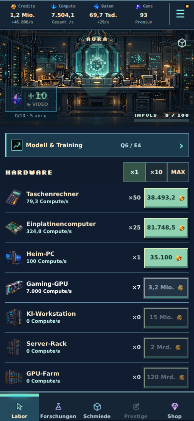
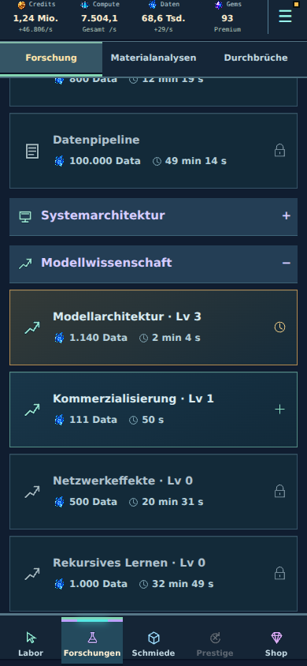

# Frühe Progression überarbeitet · Beta 9

Die frühe Hardwarekurve und die ersten Forschungsschritte sind auf kürzere Fortschrittsabstände abgestimmt. Der erste sinnvolle Reset mit drei INT liegt im aktiven Vergleich jetzt bei etwa **49–54 Minuten**; die erste einzelne INT ist bereits nach **39–42 Minuten** erreichbar. Es gibt keine neue Mindestspielzeit und keine zusätzlichen Prestigesperren.

## Konkrete Änderungen

Alle Spielwerte liegen weiterhin ausschließlich in `src/economy.ts`.

| Hardware | Basispreis vorher → jetzt | Preiswachstum je Kauf vorher → jetzt |
| --- | ---: | ---: |
| Einplatinencomputer | 6.000 → 2.000 | 1,18 → 1,16 |
| Heim-PC | 100.000 → 30.000 | 1,19 → 1,17 |
| Gaming-GPU | 4 Mio. → 1 Mio. | 1,20 → 1,18 |
| KI-Workstation | 75 Mio. → 15 Mio. | 1,21 → 1,19 |
| Server-Rack | 15 Mrd. → 2 Mrd. | 1,22 → 1,20 |

Taschenrechner sowie die neun Klassen ab GPU-Farm behalten ihre Preise. Compute je Gerät, Meilensteine, Grundumsatz, Trainingskosten und INT-/Axiom-Formeln bleiben erhalten. Hardware kostet weiterhin ausschließlich Credits.

Acht frühe Forschungsreihen erhalten fünf statt drei Einstiegsstufen: Datenerzeugung, Materialanalyse, Bauplananalyse, Modellarchitektur, Compute-Optimierung, Nutzerskalierung, Kommerzialisierung und Hardware-Integration. Basiszeiten: **30 / 60 / 90 / 150 / 240 Sekunden**, anschließend reguläre Zeitkurve. Die zur Kostenberechnung verwendete Basis wird auf **30 / 60 / 120 / 180 / 250 Daten** begrenzt; darauf wird das bestehende Levelwachstum angewendet. Dies sind ausdrücklich keine pauschalen Endpreise von 30 bis 250 Daten. Effekte und Voraussetzungen bleiben gleich.

Die Projekte Labororganisation, Offene Baupläne und Reproduzierbare Modelle benötigen regulär 180, 150 und 450 Sekunden statt 300, 300 und 900 Sekunden, jeweils vor Forschungsgeschwindigkeit.

## Gleiche Spielstrategie vor und nach der Änderung

Vergleich gegen den gemergten Stand `ccb61ca`. Der Simulator verwendet reale Kauf-, Trainings-, Forschungs-, Item- und Prestigeaktionen. Horizont drei Stunden; keine Questbelohnungen, bezahlten Angebote, Werbevideos oder künstlichen Geld-/INT-Zuschüsse. Messprotokoll mit Preisen, Käufen und Checkpoints: [Vorher/Nachher](early-balance-before-after.json).

| Profil | Erste INT vorher → nachher | Erster tatsächlicher Reset mit 3 INT vorher → nachher | Dauer des zweiten Runs für weitere 3 INT |
| --- | ---: | ---: | ---: |
| Regelmäßig aktiv | 79,7 min → 38,6 min | 105,3 min → 48,5 min | 32,8 min |
| Wenig Taps, Entscheidungen alle 30 s | 94,6 min → 42,4 min | 121,5 min → 53,5 min | 39,0 min |
| Rückkehr alle fünf Minuten | 120,7 min → 79,8 min | 150,0 min → 105,0 min | nicht erreicht |

Nach dem Reset werden T01 und H01 mit den verdienten drei INT gekauft; die Simulation aktiviert keine zusätzliche gekaufte Automatisierung. Forschung und Items werden nach den bestehenden Regeln behalten. Der Heim-PC wird im zweiten aktiven Run nach etwa 5–6½ Minuten wieder erreicht, statt nach etwa 11½–12½ Minuten im ersten. Der zweite komplette Run benötigt etwa 33–39 Minuten.

Das Profil „regelmäßig aktiv“ tippt einmal pro Sekunde und entscheidet alle zehn Sekunden. „Wenig Taps“ entscheidet alle 30 Sekunden und tippt nach der ersten Minute nur alle 30 Sekunden. Das Rückkehrprofil schaut alle fünf Minuten herein; es spielt nicht unbemerkt durchgehend aktiv. Alle Profile wählen Käufe systematisch nach marginaler Rohleistung pro Credit. Diese optimierte Strategie ist keine Zusage, dass jeder Mensch dieselbe Zeit erreicht. In den ersten zehn Minuten beträgt die längste gemessene Lücke zwischen mindestens fünfprozentigen dauerhaften Produktionsverbesserungen in den beiden häufig entscheidenden Profilen höchstens 90 Sekunden; tägliche Langzeit-Retention wird damit nicht nachgewiesen.

Reproduktion eines Profils:

```bash
npm run balance:early -- casual node_modules/.cache/early-casual.json
```

`engaged` und `returning` sind die anderen Profile. Für einen Vergleich mit dem früheren Stand dieselben Simulator-Dateien in einem separaten Checkout des oben genannten Basiscommits ausführen; die Messung verändert keine globalen Balancewerte zur Laufzeit.

## Bestehender Reportzustand

Aus dem anonymisierten Teilzustand mit 82 Geräten, Q6/E4, denselben sechs Items, etwa 3,81 Mio. Credits und 0,245 INT lässt sich die ursprüngliche Produktion von 40.568,60 Credits/s reproduzieren. Rekonstruktionsdaten (historischer Nachweis: Git-Historie vor Bereinigung). Dies ist kein vollständiger Save und kein Ersatz für den Originalexport.

Die nächste GPU ist jetzt mit dem vorhandenen Guthaben kaufbar: ungefähr 2,7 Mio. Credits für Gerät sieben. Modellarchitektur Stufe vier kostet in diesem Zustand 1.140 Daten und dauert rund 123 Sekunden statt einer langen Laborblockade. In der fortgeführten Vergleichsstrategie liegt die erste ganze INT nach etwa 18,7 min statt 47,8 min; zusätzliche Käufe werden dabei tatsächlich bezahlt. Diese Zeiten beginnen am rekonstruierten Reportzustand, nicht bei einem neuen Spiel.

## Exportkorrektur

Die zuvor im Bericht für fünf spätere Projekte ausgewiesenen Millionen-/Milliardenpreise stammten aus der alten Preisfunktion, obwohl das Spiel bereits V2-Angebote verwendete. Das war ein Exportfehler. Beispielsweise kostet Datenpipeline regulär **100.000 Daten**, nicht 937,6 Mio. Die vorherige Interpretation dieser Exportwerte als reale aktuelle Forschungswall war daher zu korrigieren.

`dataSaving.nextResearchCosts` verwendet jetzt dieselbe Quote wie die Spieloberfläche. `nextResearchQuotes` ergänzt tatsächliche Dauer, Freigabestatus und fehlende Voraussetzungen. Ein günstiger aufgeführtes Projekt ist dadurch nicht automatisch bereits freigeschaltet.

## Schutz bestehender Spielstände und Abnahme

Keine Änderung des Saveformats oder des INT-Basiswerts; bereits angesammelte INT-Entitlements müssen nicht umgerechnet werden. Vorhandene Geräte, Items, Materialien und Forschung bleiben erhalten. Neue Angebote verwenden die neue Kurve; bereits bezahlte Forschungsaufträge behalten ihre gespeicherten Kosten und ihren Arbeitsvertrag. Keine rückwirkenden Preisrefunds oder zusätzlichen Freiwährungen.

Die historischen Parameter-Guards erlauben exakt die zehn freigegebenen Preis-/Wachstumsänderungen. Produktion und alle anderen geschützten Felder werden weiter verglichen; zusätzliche versehentliche Änderungen werden nicht ausgeblendet. Eine veraltete Legacy-Simulationsannahme „vor 45 Minuten kann kein Reset stattfinden“ ist durch eine Prüfung der tatsächlich gewählten Ein-/Drei-INT-Strategie ersetzt.

- Typecheck und Produktionsbuild unter Node 22 bestanden; bestehende Warnung zum großen Hauptbundle bleibt.
- 218 gezielte Vertrags-/Balanceprüfungen bestanden; die fünf neuen Abnahmeprüfungen decken danach zusätzlich eine historische, langsamere Forschungsarbeit über Reload und 240 Sekunden Fortschritt ab.
- Vollständiger Testlauf: **1.710 Tests in 122 Dateien bestanden**.
- Browser 320/390/430 px: GPU sieben tatsächlich gekauft, schnelle Modellarchitektur bezahlt und gestartet, beides gespeichert und nach Reload vorhanden; keine Seitenüberbreite oder Laufzeitfehler. [Browserprotokoll](early-balance-browser-results.json).
- Echte iPhone-/WKWebView-Abnahme sowie weitere natürliche Runs über mehrere Prestiges bleiben zum Feinabgleich offen.



