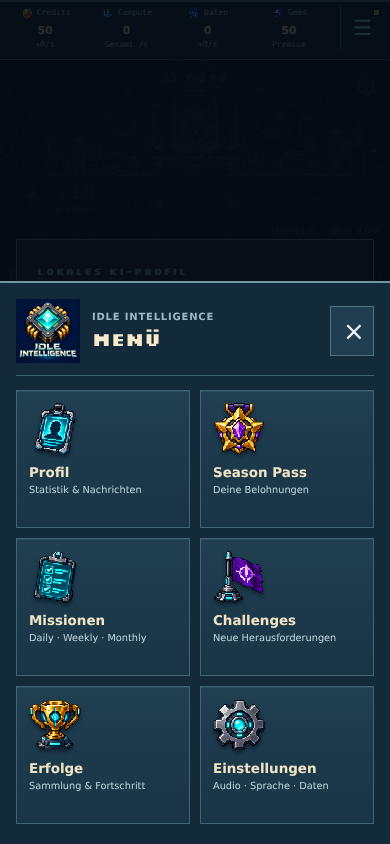

# Idle Intelligence · bestätigtes Branding

Der freigegebene KI-Chip mit türkisfarbenem Kern, goldenen Kontakten und dem Schriftzug **IDLE INTELLIGENCE** ist integriert. Das freigegebene Motiv wurde nur proportional für die benötigten Exportgrößen skaliert; kein neuer Entwurf und kein Beschnitt.

- Web: PNG-Favicon, Apple-Touch-Icon (180 px), Webmanifest mit 192-/512-px-Icons und aktualisierter Dokumenttitel.
- Spiel: Logo im vorhandenen Menü-Kopf; Shop, Einstellungen und Teilen-Dialog verwenden den neuen Namen. Der Langzeitbericht trägt den neuen Titel.
- Native: deckende 1024-px-PNG für iOS/App Store unter `resources/branding/app-icon-1024.png`, Android-Launcher-Exporte für fünf Pixeldichten sowie ein gepolstertes adaptives Vordergrundbild. Die äußere Icon-Maske übernimmt das Betriebssystem.
- `scripts/apply-branding.mjs` übernimmt nach Bedarf nur Icon-Ressourcen und sichtbare App-Namen in vorhandene Standard-Capacitor-Projekte. Plattform-Eingaben werden vor Änderungen validiert. Bundle-ID, Paket-ID, URL-Schema, Speicherkennungen und Kaufprodukt-IDs bleiben erhalten.

## Auf dem Mac

Nach Merge dieses Pull Requests im vorhandenen Projektordner:

```bash
git pull
npm ci
npm run ios:prepare
```

`ios:prepare` führt Build, Capacitor-Sync, Icon-/Namensübernahme und Öffnen von Xcode in dieser Reihenfolge aus. Ein fehlgeschlagener Schritt stoppt den Ablauf. In Xcode anschließend neu bauen und starten. `cap sync` allein ersetzt keine App-Icons.

Separat kann `npm run branding:apply` vorhandene iOS- und/oder Android-Projekte aktualisieren. Ohne native Projektordner gibt es einen Hinweis und keine vorgetäuschte Übernahme. Android Studio anschließend selbst neu bauen lassen.

Die nativen Projektordner sind in diesem Repository nicht vorhanden. Daher kann der Mac-spezifische Xcode-Build hier nicht durchgeführt werden. Abweichende eigene Targets, andere Asset-Kataloge oder lokalisierte native App-Namen sind manuell mit dem Standardpfad abzugleichen. App-Store-Connect-Name und Google-Play-Listing werden durch diese Codeänderung nicht automatisch umbenannt. Marken-/Namensverfügbarkeit wurde nicht geprüft.

## Abnahme

- Node 22: Typecheck und Produktionsbuild bestanden; vorhandene Warnung zum großen Hauptbundle bleibt bestehen.
- Vollständige Testsuite: **1.652 Tests in 119 Dateien bestanden**.
- `npm test -- scripts/apply-branding.test.mjs`: nativer Übernahmetest bestanden, mit wiederholbarer Anwendung und unveränderten Paket-/Bundle-IDs sowie bestehenden Einstellungen. Auch gegen die tatsächlich installierten Capacitor-8-iOS-SPM-/Android-Vorlagen erfolgreich ausgeführt.
- Browser bei 320, 390 und 430 px: Logo geladen, neuer Dokument- und Menüname, Manifest und Icon-Dateien erreichbar, keine Seitenüberbreite oder Laufzeitfehler. [Messprotokoll](branding-browser-results.json); reproduzierbar mit `scripts/branding-audit.mjs`.



## Grafikquelle

Vom Nutzer bestätigter ImageGen-Entwurf vom 18.10.2026, anschließend bestätigte Schriftzug-Variante. Promptinhalt: bestehenden dunklen Mikrochip mit Goldkontakten und türkisfarbenem Kristall erhalten; darunter zweizeilig exakt „IDLE“ und „INTELLIGENCE“ in kantiger silberner Sci-Fi-Schrift, dunkler Hintergrund, quadratische Komposition. Keine weiteren generativen Änderungen bei der Integration.
