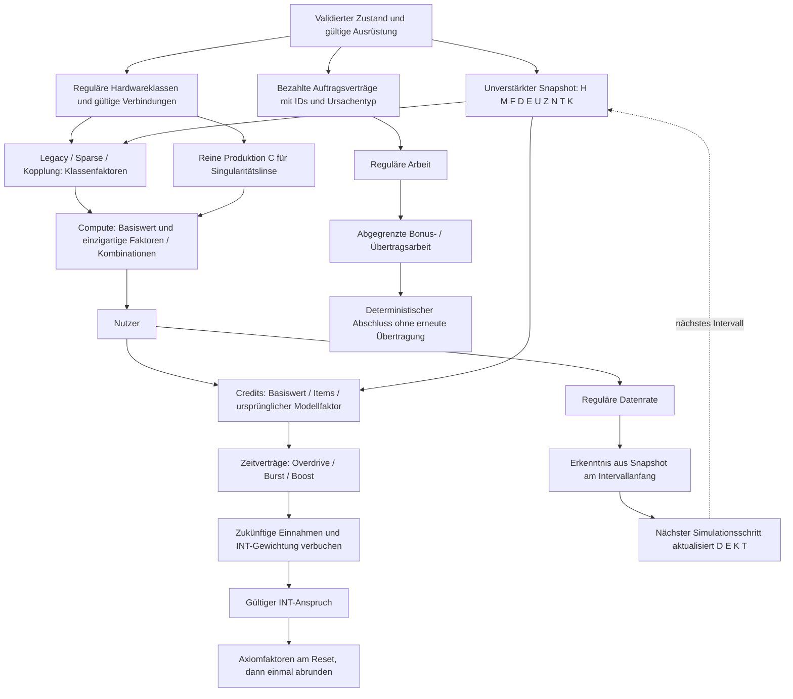

# Item-System V3 – Umsetzung und Abnahme

Verbindlicher Auftrag: [unveränderte Spezifikation](specification.txt). Beginn 28.10.2026 auf `codex/unity-rewrite`; Remote-PR #155 bereits gemergt. Lokale UI-/Lokalisierungsnacharbeiten bleiben separat erhalten. V3 ist noch **nicht** im normalen Spiel aktiviert. Keine Fertigmeldung durch bloße Katalogeinträge.

Ergänzt durch den verbindlichen [Prestige-/Axiomauftrag](prestige-axiom-specification.txt). Dieser erweitert denselben V3-Vertrag. Die 60/24 bestehenden IDs und Preise bleiben erhalten. K (Komponentenproduktion im Itemauftrag) und K (Hardwareklassen im Prestigeauftrag) erhalten im Code getrennte ausgeschriebene Namen; sie sind keine neue Währung.

Aktuelle ausdrücklich bestätigte Änderungen zur ursprünglichen Spezifikation: [Ergänzungen, einschließlich linearem INT-Einkommen](amendments.md). Diese haben für die betroffenen Regeln Vorrang.

## Abhängigkeitsgraph vor der Implementierung

Keine Rückkante innerhalb einer Auswertung: insbesondere C ohne globale Faktoren, Modell-Revenue nur einmal, Erkenntnis nicht aus ihrem eigenen Intervallzuwachs. Materialprovenienz und Fraktionen gehören in den gespeicherten Vertrag, nicht in Animationen oder berechnete Handelsboni.

## Festgestellte Bestandsabweichungen

- Aktuelle Quelle verwendet Progression V2 und `ScientificNumber`; Unity hat denselben separat portierten Verbrauchergraphen. Neue Konstanten werden ausschließlich aus `src/economy.ts` generiert.
- Qualität/Effizienz besitzen einen logarithmischen Softcap, keinen Potenz-Softcap. Adapter für Distillation muss die vorhandene Ausgabekurve kontinuierlich abmildern; Curriculum verschiebt zuvor die Schwelle. Integration bleibt unverändert.
- Erkenntnisarchiv hat derzeit einen Nullpreis-Bauplan, den der normale Lernweg wegen `price > 0` nicht erwerben kann. Expliziter erreichbarer Erwerb ist Teil von V3, kein alter vermeintlich abgeschlossener Verbraucher.
- Aktuelle Saveversionen: Web 64; native Version wird vor Migration separat ermittelt. Neue Zähler dürfen nicht aus Walletbeständen oder unzuverlässigen Lifetimezahlen rekonstruiert werden.
- Slotfamilien und drei Startslots bestehen bereits. Zusätzliche Forschungs-/Prozessorslots sind für entsprechende Dreierkombinationen tatsächlich erforderlich.

## Abnahmereihenfolge

- [ ] Unveränderte Baseline mit Quellfingerabdruck, natürlichen Profilen und getrennten vorbereiteten Referenzzuständen.
- [ ] Zentrale Konstanten, ScientificNumber-Formeln, sämtliche globalen Verstärker inventarisiert.
- [ ] Produktions- und Trainings-/Forschungsverbraucher, alle 42 Fähigkeiten und 12 Kombinationen.
- [ ] Ereignisursachen, gespeicherte Startverträge, Produktionszähler, Provenienz und Offlinegrenzen.
- [ ] Konkrete Rezepte, erreichbarer deterministischer Erwerb, neue Originalgrafiken.
- [ ] Atomare Migration mit Originalkopie, Duplikatbereinigung ohne Itemverlust, Challenges/Handel.
- [ ] Tatsächliche Itemdetails, Vergleiche, Kombinationen, Mira-Hinweise und sieben Sprachen.
- [ ] TS-/C#-Parität, volle Regressionen, lange Nachherkampagnen und Loadoutsuche.
- [ ] Echte Unity-Bilder und Clip, abschließender geprüfter Commit und Draft-PR.

Alle Punkte bleiben offen, bis der tatsächliche Verbraucher und sein Nachweis vorliegen. Produktionscloud/Storekonten sind keine Voraussetzung dieses lokalen Itemumbaus und bleiben separat offen.

## Geprüfte Zwischenstände, keine Gesamtfreigabe

- UI-Nacharbeiten aus dem vorherigen Auftrag in eigenem Commit `3436a08c` gesichert; davor 30 EditMode- und 4 PlayMode-Tests grün. Kein PR-Merge. Eine lokale Fast-forward-Anfrage wurde von der automatischen Freigabe abgelehnt und nicht ausgeführt.
- Erste Itemproduktionsstufe: `/tmp/idle-v3-initial-edit-fixed.xml`, 8/8 Tests, 7,893 s; darunter damals 32 tatsächliche TS-/C#-Verbraucherzustände sowie die bestehenden Itemparitätsprüfungen. Ein vorheriger Compile fand eine nicht vorhandene C#-`Sqrt`-Methode; auf die vorhandene `Pow(.5)`-API korrigiert.
- Gemeinsame Produktions-/Prestigestufe: `/tmp/idle-v3-joint-edit.xml`, 8/8 Tests, 8,131 s, inzwischen 53 Referenzzustände. Diese vergleichen echte Compute-/Income-/Data-/WorkSpeed-/KnowledgeRate-Verbraucher, keine nebenher nachgebaute Testökonomie.
- `/tmp/idle-v3-queue-unit.log`: 33/33 TS-Tests (21 Item-, 7 Prestige-, 5 Queuefälle) bestanden. Neue Queue- und mobile PlayMode-Prüfungen laufen separat; ihr Ergebnis ist noch nicht vorweggenommen.
- Baseline erfasst `baseline.json` schrittweise mit dem Fingerabdruck der unveränderten geladenen TS-Quellen und ohne Ressourceninjektion. Bisher aktive Profile bis sieben Tage: kein ungültiger Zustand, erster Prestige bis 24 h, 12 Prestiges nach sieben Tagen. 30/90 Tage und passive Profile sind noch nicht vollständig vorliegend. Keine abgeschlossene Monatsbalance behaupten.

### Noch nicht im normalen Spiel freigegeben

Aktuelle Web-/native Saveversionen bleiben 64/24. Der experimentelle V3-Vertrag ist ausschließlich für isolierte Referenzzustände zugänglich. Beide Speichergrenzen verweigern ausdrücklich das Schreiben solcher Zwischenstände, statt unvollständige Zähler oder Vertragsdaten zu verlieren. Bestehende reguläre Saves werden nicht automatisch aktiviert oder umetikettiert.

Noch offen sind insbesondere: die vollständigen 42 Itemfähigkeiten samt tatsächlichen Ereignisverbrauchern, sechs neue Erwerbswege und Originalicons, Produktions-/Auftrags-/Resetverträge und atomare Migration, alle zwölf Kombinationen inklusive Slotbeweisen, restliche 60/24-Knotenverbraucher und Texte, spoilerfreie UI-Sichtbarkeit, Mira-Entdeckungsführung, erste manuelle Axiomtransaktion, Automation/Batches/Materialschutz und lange gemeinsame Nachherkampagnen. Reine Formelfunktionen oder vorbereitete Referenzzustände schließen diese Punkte nicht ab.

## Logarithmischer Trainingssoftcap: konkreter Adapter

Die aktuelle Quelle verwendet nach der Schwelle `b` die Kurve `g(d)=s·ln(1+d/s)`, `d=level-b`, `s=25`, nicht `d^a`. Curriculum verschiebt zuerst `b`. Distillation setzt `rho=0,20Q/(1+0,20Q)` und verwendet danach `b + g(d)^(1-rho)·d^rho`.

Bei `rho=0` ist dies exakt die alte Kurve. Für `d>0` sind beide Faktoren positiv und streng monoton; das Produkt ebenfalls. `g(d)/d → 1` bei `d → 0`, somit stimmen Wert und erste Ableitung am Schwellenübergang überein. Aus `0<g'(d)≤g(d)/d≤1` folgt `0<f'(d)≤1`; daher kann auch das Anheben der Schwelle die Ausgabe nicht senken. Der Adapter liegt zwischen alter logarithmischer und linearer Ausgabe, erreicht die lineare Kurve wegen `rho<1` nicht. Keine Änderung der Integrationskurve und keine zusätzliche Drossel. Der gemeinsame Level-Sweep wird an den tatsächlichen Qualitäts-/Effizienzverbrauchern geprüft.

## Unbezahlte Queueverträge

Bestehende Trainings-/Forschungsqueues sind Pläne, keine bezahlten Reservierungen. Karten zeigen daher kompakt „Zahlung bei Start“. Umordnen und Entfernen verwenden einen gespeicherten UI-Snapshot als Transaktionsticket; nach einem Start oder einer anderen Änderung wird ein veraltetes Ticket abgewiesen. Gleiche Trainingstracks dürfen ihre Ziellevelreihenfolge nicht umkehren. Das Entfernen eines früheren Ziels entfernt weiterhin dessen spätere abhängige Ziele desselben Tracks, entsprechend der vorhandenen Regel. Kosten und Start-/Refundverträge bleiben unverändert.

## Zweiter gemeinsamer Prüfstand: 28.10.2026

Der experimentelle Rechenpfad umfasst jetzt 62 vorbereitete tatsächliche TS-/C#-Verbraucherfälle. Hinzu kamen F07-Neustartkosten (alte bezahlte Verträge bleiben), F08 aus belegten regulären Slots und F10 aus F; D05 und die native Integrationsgrenze verwenden dieselbe V3-Basis. Axiomkäufe vor Entdeckung werden abgewiesen; B06 darf den ersten Reset nicht automatisch auslösen. Relative Prestige-Automation pausiert ohne positiven Referenzgewinn auch bei erreichtem Timeout.

D/E/T werden aus tatsächlichen angerechneten Zeitintervallen verbucht. Der V3-Auswertungssnapshot liegt vor der neuen E-Buchung; Startgeschenke zählen nicht als Produktion. Wiederholtes Advance auf denselben Zeitpunkt verbucht nichts. Normales Prestige leert D/T/Lernserie, Axiomreset zusätzlich E/K. **K-Produzenten, vollständige Ereignisverträge und beliebige externe Intervallteilungen sind noch nicht vollständig abgenommen.**

- `npm run typecheck`: bestanden; `npm run build`: bestanden, bestehender Hinweis auf große Webchunks.
- Vollständiger TS-Lauf `/tmp/idle-v3-regenerated-vitest.log`: **152 Dateien / 1.989 Tests bestanden**, 331,18 s. Ein vorheriger Lauf fand veraltete Generatorhashes während der Erweiterung und einen falschen Testimport; anschließend alle Generatoren neu erstellt, Test korrigiert und vollständig wiederholt.
- `npm run unity:check`: vollständig bestanden (`/tmp/idle-v3-final-generated-check.log`).
- Unity Compile + gesamter EditMode-Lauf `/tmp/idle-v3-final-verified-edit.xml`: **188/188 bestanden**, 128,159 s. Vorlauf 187/188: Test setzte reguläre Erkenntnis fälschlich mit dem Walletdelta einschließlich Labor-Startgeschenk gleich. Vergleich auf gemessene Produktion korrigiert; Startgeschenk explizit ausgeschlossen.
- Gezielter Queue-/Navigationslauf `/tmp/idle-v3-retained-lab-play.xml`: **8/8 bestanden**, 65,898 s. Ein erster Gesamtlauf fand zwei veraltete Laborkindpfade und eine Localeannahme; korrigiert. Ein weiterer Gesamtlauf mit irrtümlichem `-nographics` hatte RenderTexture-Fehler und zählt ausdrücklich nicht als Grafikabnahme. Der abschließende vollständige Lauf mit Grafikgerät `/tmp/idle-v3-verified-full-play.xml` hat **129/129 bestanden**, 673,787 s; inklusive echter Game-View-Breitenassertionen und der neuen Queuebilder.
- [22 unveränderte Unity-Bilder](../media/unity-v3-queues/README.md): zwei Queuerouten, DE/EN 320/390/430, weitere fünf Sprachen 390. DE/EN selbst angesehen und gefundene Platz-/Umbruchfehler korrigiert. Vorbereitete isolierte Finanzierung und 25-%-Arbeitsstände ausdrücklich markiert. Kein physischer Gerätenachweis.
- [Sechs neue Originalmotive](art/README.md) mit eingebautem `image_gen` erstellt, Alpha beibehalten und einzeln angesehen. Kein laufender Itemkatalog-/Spriteimport- oder Animationsnachweis; bestehende Grafiken unangetastet.

### Unveränderte Baseline und Laufzeitgrenzen

Die ursprünglich geladene Quelle hat Fingerabdruck `f4a45250c30b8ed7490856a5b58983e1b85f24a457466d965476eabec0f0662b`. Derselbe vollständige Inhalt aller 330 verfolgten `src`-Dateien wurde aus Git `3436a08c` rekonstruiert und byteweise gehasht; identisch mit der vor den V3-Änderungen gestarteten Baseline. Ein separater Passivlauf benutzt ausschließlich diese eingefrorenen Quellen und verweigert einen abweichenden Fingerabdruck. Kein Spielsave wurde kopiert, kein verschachteltes Git-Repository erstellt.

`baseline.json` enthält aktive natürliche Profile bis 30 Tage, 46 Prestiges, keine ungültigen Zustände; der aktive 90-Tage-Lauf ist noch offen. `baseline-passive.json` erfasst die unabhängigen natürlichen Passivprofile schrittweise; inzwischen bis 30 Tage, 16 Prestiges, keine ungültigen Zustände; 90 Tage noch offen. Beide benutzen den bestehenden Simulator/Seed 1708 ohne Ressourceninjektion. Laufzeitangaben enthalten Mac-Unterbrechungen und sind keine CPU- oder Geräteperformance-Messung. Noch keine Nachherkampagne und keine abgeschlossene Monats-/90-Tage-/Buildbalance behaupten.

## Nachweis Editor-Anbindung und sicherer Spriteimport

Offizielles `com.unity.pipeline@0.9.1-exp.1` über `unity pipeline install` ergänzt; vorhandene Pakete/SDK-Sperren erhalten. Eine eigene Instanz von 6000.3.26f1 importierte die sechs neuen PNGs über Live-`script eval_file`; alle Pivot-Capabilities positiv, sechs eigenständige Sprites und GUIDs im Assetkatalog/Project-Auswahl verifiziert. Echte Console nach Import/Play: null Fehler, keine fehlgeschlagene Kompilierung. Originalbytes erhalten; Importmaximalgröße512, Point, keine Mipmaps, keine Kompression. Noch keine Katalogfreigabe.

Live-Play begann aus einer leeren eigenen Szene; erst danach wurde der temporäre Savepfad gesetzt und die echte Spielszene geladen. Nachgewiesener Framefortschritt: 163328 → 163335, zwei beobachtete Frames, 125 ms; keine Performance-/60-fps-Behauptung. Die echte 390×846-Aufnahme wurde selbst angesehen und unverändert nach `docs/media/unity-v3-queues/live-pipeline-390.png` kopiert. Der Capture-Befehl legte seinen Pfad in dieser Paketversion unter Assets ab; der ausschließlich von ihm erzeugte temporäre Capture-Asset wurde danach über AssetDatabase entfernt. Keine normalen Saves oder Szenen geändert. Eigene Play-Sitzung beendet, sitzungsbezogene Hintergrundoptionen zurückgesetzt und eigener Editor nach SaveAssets sauber geschlossen.

Ein nicht wartender CLI-Start beendete sich nach „ready“; keine funktionierende Live-Anbindung daraus behauptet. Der zulässige wartende Start plus separate Bereitschaftsprüfung wurde tatsächlich nachgewiesen. [Maschinenlesbarer Nachweis](art/live-editor-proof.json), [Spriteimport](art/unity-import.json). Nachprüfung mit installiertem Editorpaket: Compile + **8/8 EditMode**, 5,062 s (`/tmp/idle-v3-pipeline-import-edit.xml`), und **5/5 PlayMode**, 31,977 s (`/tmp/idle-v3-pipeline-import-play.xml`), Queues sowie bestehende Modell-/Slotdarstellung. Die vorherige188/129-Vollregression gilt für den geprüften Commit9550fac2.

## Archiv-Erwerb: tatsächliche Verbraucher, keine Savefreigabe

Der V3-Lernweg verwendet nun das bestehende I04-/researchArchive-Recht; keine erfundenen Ersatzkosten. Gültige frühere Rechte und gelerntes Rezept bleiben nutzbar, fehlende Bauplanforschung oder bloße Finanzierung reichen nicht. Lernen vergibt kein Item. Die tatsächliche Sofortherstellung bleibt bezahlt. Neue Sperrbeschriftung verwendet den wirklichen Knotennamen statt einer technischen ID und ist zentral in sieben Sprachen hinterlegt.

- 49 gezielte Vitest inklusive bisheriger Blueprintverträge bestanden; tatsächlicher I04-Kauf sowie echter Axiomreset mit Item-/Rezepterhaltung im TS-Fall.
- 62 Produktionsfälle plus **11 neue tatsächliche Archiv-Erwerbs-/Zahlungsfälle** werden aus TS generiert. Unity Compile/9 EditMode-Prüfungen bestanden, 5,405 s (`/tmp/idle-v3-archive-edit.xml`). Bestehende Schmiede-/Queue-PlayMode-Regression **5/5**, 23,809 s (`/tmp/idle-v3-archive-play.xml`).
- Typecheck/Build bestanden, vollständiger Generatorvergleich bestanden; vollständiger erneuter TS-Lauf **153 Dateien / 1.992 Tests bestanden**, 323,03 s (`/tmp/idle-v3-archive-full-vitest.log`).

Das ist ein experimenteller V3-Domainvertrag, keine fertige Save-Migration oder Spielerfreigabe. Insbesondere muss die vollständige native/Web-Migration das rechtmäßige Legacyrecht tatsächlich übernehmen. Bestehende reguläre Saves bleiben64/24, der V3-Schreibschutz bleibt aktiv. Weitere Ereignisverbraucher und die V3-Erwerbs-/Detailoberfläche sind offen.

### Baseline-Präzisierung nach vollständigem Passivlauf

Alle neun Passivzeitpunkte bis90Tage sind nun abgeschlossen:44Prestiges, invalid=false, kein Timeout/keine Warnung; geplante, angerechnete und verworfene Zeiten stimmen mit dem bestehenden Schedule überein. [Genaue Grenzen](baseline-notes.md): bestehende Domainstrategie ohne vollständige Mira-/Modell-/Axiom-/Loadoutführung. Alte Legacy-Diagnosekatalogtexte sind keine aktuellen60/24-Kaufregeln. Rohberichte unverändert; keine vollständige V3-/Monatsbalance daraus behaupten. Aktiver90-Tage-Lauf später abgeschlossen (149Prestiges); erweiterte Kampagnen weiter offen.

## 29.10.2026 – Lernserie und eindeutige Trainingsereignisse

Logik-Saat ist nun an tatsächliche regulär bezahlte aktive Q/E-Abschlüsse angeschlossen. Eindeutige IDs werden nach Start/Zahlung erzeugt; Abschlussmarker/Ursache verhindern zusätzliche Fortschritte bei Wiederholung. Intro/Bonus/Integration/No-items sind ausgeschlossen, Ablegen erhält die Serie. Wirkliche Resets leeren die Serie, erhalten aber monotone IDs. Persönliche Daten hängen am Spielzustand, nicht an handelbaren Itempayloads.

- **6 gemeinsame vollständige TS-/C#-Trainingsfolgen** zusätzlich zu62Produktions- und11Archivfällen. Tatsächliche Debitwerte, Tempo, Level, IDs und Ursachen werden verglichen.
- Typecheck/Build und vollständiger Generatorvergleich bestanden; **154Dateien /1.999Vitest**, 317,34s.
- Unity Compile/gezielt11EditMode grün; danach **191/191 vollständige EditMode**, 127,321s (`/tmp/idle-v3-learning-full-edit.xml`).
- Tatsächliche Szene, Einführungstrainings-Abschlussfeedback und Queues/Reload **9/9 PlayMode**, 47,824s (`/tmp/idle-v3-learning-play.xml`). Die frühere129er-Voll-PlayMode-Abnahme bleibt ein eigener vorheriger Stand; keine Behauptung eines neuen vollständigen PlayMode-Laufs.
- Tests fanden einen irrtümlichen Reset der neuen ID-Zähler im TS-Resethelfer; korrigiert und über echte Resettransaktionen gegen C# geprüft. Zwei andere Testaufbauten mussten gültige Challenge-Metriken und den wirklichen Intro-Tutorialkontext verwenden; keine Spielregeln dafür geändert.

Die vollständige V3-Dateimigration bleibt offen und der Schreibschutz aktiv. Photonen-/Drohnen-/Gradientüberträge, weitere Ereignisfähigkeiten, vollständige Item-/Knoten-UI und Langkampagnen bleiben konkrete folgende Arbeiten.

## 29.10.2026 – Wissenschaftliche permanente Item-Basisfaktoren

Compute- und Credits-Basisboni behalten nun in TS und C# den wissenschaftlichen Faktor aus Legacy-Zyklus- und permanenten Rechten. Keine Umwandlung des Faktors in eine beschränkte normale Zahl vor der tatsächlichen Produktionsmultiplikation. Rohes P/Q und einzigartige Fähigkeiten erhalten diesen Faktor nicht zusätzlich. Normale Regeln verwenden weiterhin den bisherigen Zahlenadapter.

Neun zusätzliche gemeinsame Produktionsfälle prüfen einzelne Prozessor-/Kernitems und kombinierte Ausrüstung mit Legacyfaktoren1,10^1000 und10^10000 je Rechteklasse: Gesamtbasis damit bis10^20000. Unabhängiger Vitest prüft den erwarteten Faktor1+0,1×LegacyCycle×LegacyPermanent, die tatsächliche Produktionsquote und das Entfernen der Ausrüstung. Der erste Testaufbau verwendete irrtümlich das Prozessoritem Neural-ASIC als Kern; auf den echten Kern Speicherkristall korrigiert, keine Slotregel geändert. 46 gezielte Vitest bestanden.

**Grenze:** Arbeitsraten/-anforderungen für Training/Forschung und verbleibende Migrationsrechte sind damit nicht vollständig wissenschaftlich umgebaut. Die bisherigen numerischen Arbeitsadapter, Altimport und alle noch offenen Ereignisverträge bleiben separat offen. Keine V3-Aktivierung, keine Saveversionänderung und keine neue Balancekonstante. Vollständige Regressionsergebnisse werden nach Abschluss ergänzt.

Wissenschaftliche-Basis-Nachprüfung: vollständige191/191EditMode (127,753s) und9/9gezieltePlayMode (47,290s), Typecheck/Webbuild und vollständiger Generatorvergleich bestanden. Ein erster falsch qualifizierter PlayMode-Filter wählte null Tests und gilt ausdrücklich nicht als Abnahme; Namespace korrigiert und echte neun Tests wiederholt. Nachweise: `/tmp/idle-v3-scientific-edit.xml`, `/tmp/idle-v3-scientific-play-corrected.xml`.

Vollständiger TS-Lauf für diesen Stand:154Dateien/2.000Tests bestanden,323,84s (`/tmp/idle-v3-scientific-full-vitest.log`). Die Sandbox meldete einen fehlgeschlagenen Vite-Websocket-Listener; Tests wurden vollständig beendet, Exit0, keine fehlgeschlagenen Tests. Kein Netz-/Cloud-Erfolgsnachweis daraus.

## 29.10.2026 – T06: ausdrücklich gewünschte Integration

Experimentelle V3-Automation startet Integration nur bei positivem Ziel und bis zum tatsächlichen Ziellevel. Derselbe Vertrag gilt für den dafür geschützten Datenbetrag. Manuelle Pläne bleiben vor der Automation; Nullziel bedeutet für Q/E weiterhin unbegrenzt, für V3-Integration ausschließlich manuell. Niedrigeres Q/E-Level wird bei freier Wahl bevorzugt, Gleichstand stabil Qualität zuerst. Normale Saves behalten ihr bisheriges Nullzielverhalten.

Acht neue gemeinsame echte Start-/Zahlungs-/Reservierungsfälle: kein Integrationsziel, positives Ziel, erfülltes Ziel, niedrigeres Effizienzlevel, manuelle Integration, manueller Effizienzplan, alle endlichen Ziele erfüllt, bisheriger Normalmodus. 25 gezielte Vitest bestanden. Online/Offline vergleichen gleiche Aufträge, Zahlung und Arbeitsmenge; deren naturgemäß unterschiedliche Online-/Offlineprotokollfelder werden nicht fälschlich als vollständige Objektgleichheit erwartet.

Zielbeschriftungen verwenden echte lokalisierte Tracknamen in sieben Sprachen; V3-Integration erklärt „0 = nur manuell“ statt einer falschen Unbegrenzt-Aussage. Vollständige V3-Dateimigration/Spielerfreigabe und weitere Automations-/Übertragsverträge bleiben offen. Laufende Regressionsergebnisse separat nach Abschluss ergänzen.

T06-Abnahme:154Dateien/2.001Vitest,322,14s;193/193vollständigeEditMode,127,329s;10/10PlayMode vor Aufnahmepräzisierung,54,957s. Danach finale tatsächliche Zieleingabe/Reload und elf mobile Sprachbilder1/1,5,863s, mit echten bezahlten Knoten aus isolierter Finanzierung. Sechs DE/EN-Bilder selbst angesehen und alle Eingaben nach Layoutstabilisierung vollständig sichtbar. Falscher Menüweg, ungültiger vorbereiteter Ledger und im Batch nicht unterstütztes EndOfFrame-Warten wurden korrigiert; frühere Fehlläufe sind keine Freigabe. Typecheck/Webbuild/Generatorvergleich grün; zusätzliche Kopie967×7 separat geprüft. `docs/media/unity-v3-training-targets/README.md`. Nutzerentscheidung: vollständigesV3 vor Xcode-Playtest; Voraussetzungen in playtest-gate.md.

## 29.10.2026 – Tatsächliche Komponentenproduktion K

Nur ausdrückliche Produktionsbelege werden gezählt: bezahlte Analysen, Synthese, passive Hardwarefunde und bezahlte Hardware-Meilensteinpakete. Der bestehende TS-Klassenkauf ist ebenfalls explizit markiert; dessen native Erreichbarkeit hat einen Bestandswiderspruch und bleibt separat offen (`source-inconsistencies.md`). Allgemeine Zuschüsse, Starterhilfe, Shop/Gems, Handel, Import, Gutscheine, Zerlegung und Rückgewinnung zählen nicht. Ausgeben verändert den Zähler nicht. Kein Backfill aus Wallets. Keine K- oder persönlichen Produktionsdaten in Itempayloads.

Sieben neue tatsächliche gemeinsame TS-/C#-Folgen vergleichen zusätzlich echte Komponentenwallets, Credits/Daten/Gems, laufende Aufträge und Resetanzahl: Analyse genau einmal, Synthese plus mehrere echte Resetgrenzen, Hardwarepakete/passive Produktion, ausgeschlossene Zuschüsse/Shop/Abbruch, abgelehnter zweiter Start, bisheriger Normalmodus einschließlich frischer erster Synthese. 52 gezielte Vitest bestanden; erster gezielter Unity-Lauf12/12 nach Behebung des beobachteten Starterhilfe-Zeitpunkts.

Die erweiterte Parität fand einen wirklichen Zeitlaufunterschied: TS ermittelt die bestehende Starterhilfe zwischen inneren Zeitscheiben; Unity bisher nur beim Eintritt in Advance. Unity prüft nun ebenfalls zwischen Scheiben. Keine neue Belohnung oder geänderte Menge; der Beleg bleibt von K ausgeschlossen. Ein Testaufbau las zudem permanente Hardwarebelege fälschlich nur aus dem flüchtigen Journal und kaufte versehentlich49 statt50Einheiten; Erwartungs-/Eingabefehler korrigiert, keine Spielpreise dafür geändert.

Große K-Werte behalten kleine exakte Zuwächse über ScientificNumber; Nativekopien und ausgeschlossene Ursachen werden separat geprüft. V3-Dateimigration/Spielerfreigabe weiterhin gesperrt, neue Synthesekoordinator-Fähigkeit/Katalogeinbindung und weitere Quellverbraucher bleiben offen. Vollregressionsergebnisse nach Abschluss ergänzen.

Komponenten-Abnahme: vollständige155Dateien/2.006Vitest (325,12s),195/195EditMode (135,077s),18/18gezieltePlayMode (78,108s); Typecheck/Webbuild/Generatorvergleich grün. Zusätzlicher echter Craft-Preisabzug bestätigt K bleibt unverändert,5/5Komponententests. Alte Einzel-Syntheseprüfung isoliert zuvor abgeholte/verbrauchte Starterhilfe; sie erwartet weiter genau1. Frische Normal-Synthese plus echte Starterhilfe separat im siebten TS-/C#-Fluss. In-Memory-V3-Aufnahmefixture deaktiviert nun auch Fokus-/Lifecycle-Speicheraufrufe während der reinen Darstellung; produktiver Schreibschutz bleibt strikt und hatte vorher korrekt blockiert. Frühere194/195EditMode und17/18PlayMode sind keine Freigabe; korrigierte vollständige/gezielte Läufe oben. Kein neuer nativer Player installiert.

## 29.10.2026 – C01: tatsächliche passive Mengen und lesbare Knotendetails

V3 verwendet für C01 die zentralen Faktoren×2/×3/×4 statt des bisherigen additiven Bonus. Nur reguläre passive Hardwarefunde; keine Shop-/Geschenkmengen. Tatsächliche Stundenintervalle und exakte Fundgrenzen werden geprüft; V3 gleicht ausschließlich die vorhandene Bruchteilspräzision an (1e-12), damit die dritte Stunde nicht durch Rundungsreste einen Fund verliert. Kein geänderter Fundtakt. Die vorige180s-Passivfixture bewies keinen positiven Fund; elf erweiterte tatsächliche Komponentenfolgen ersetzen diese Lücke.

Alle sieben C01-Beschreibungen aus derselben TS-Quelle generiert und an echte TS-/Unity-Knotendetails angeschlossen. DE/EN320/390/430selbst gesehen, elf Originalaufnahmen unter `docs/media/unity-v3-passive-archive`. Headerflex korrigiert, nachdem französischer Titel umbrechend abgeschnitten war. Vorhandenes Spracheinstellungs-/uGUI-System beibehalten; offizielle Localization-Anleitung/API-Referenz geprüft, kein Localization-Paket installiert oder globale Übersetzungsabnahme behauptet.

Neue Währungsvergleiche fanden einen fehlerhaften finanzierten Referenzzustand: bereits gewährte INT waren nicht als beansprucht markiert. Fixtures korrigiert, echte Formeln unverändert; nun werden verfügbares Axiomguthaben, lebenslangeINT, noch ausstehende Vergabe und zwei aufeinanderfolgende Axiomresets verglichen.

Prüfungen:155Dateien/2.007Vitest(327,79s), danach26gezielte Finanzierungsfälle; Typecheck, Webbuild, Generatorprüfung grün. UnityCompile/14EditMode(9,412s),13PlayMode(58,464s), finale6UI-/Netztests(22,262s). Keine neue vollständigeUnity-Regression behauptet. Frühere fehlgeschlagene Fixtureläufe zählen nicht als Nachweis. Originale/Saves unverändert; V3-Dateimigration und vollständige Verbraucher bleiben offen, kein Xcode-Player installiert.

## 29.10.2026 – Feldscanner am tatsächlichen bezahlten Abschluss

Vorgegebene Formel2^P×[1+0,05×P×S(A,25)] an tatsächliches Analysetempo angeschlossen. A zählt ausschließlich abgeschlossene bezahlte reguläre Aufträge bei aktiver Ausrüstung. Abbruch, wiederholter Abschlussaufruf, bestehender Introauftrag, abgelehntes Zweitstarten und No-items ausgeschlossen. Ablegen erhält die Serie, beide echten Resetarten leeren sie. W10 einmal auf Fähigkeits-P. Neuer persönlicher Zähler bleibt außerhalb handelbarer Items.

Die alte gemeinsame Analyse-/Syntheserate hätte den neuen Scannerfaktor irrtümlich auch auf Synthese angewendet. Basistempo/Analysefaktor getrennt und beide tatsächlichen Verbraucher angepasst; normale Regeln bleiben gleich.17gemeinsame vollständige Produktionsfolgen vergleichen Zahlungen, Komponenten, K, Axiom-/INT-Guthaben, Scannerzähler und Live-Tempo, einschließlich späterem Ausrüsten/Ablegen und Syntheseausschluss. Eigene Grenztests0/24/25/26/1.000.000, maximale Itemstärke, W10 und Kopierisolation.

23gezielteVitest, danach vollständige156Dateien/2.011Tests(335,59s); Typecheck/Webbuild(2,19s)/vollständigeGeneratorprüfung grün. UnityCompile/15gezielteEditMode(8,922s), danach197/197vollständigeEditMode(133,690s). Abschließend8/8gezieltePlayMode(50,549s), echte Szene/Abschlussfeedback/Plan-/Reload-UI. Die Warnung „Saved feedback failed“ stammt aus dem ausdrücklich erwarteten Test eines defekten kosmetischen Verbrauchers nach erfolgreichem Speichern; kein unerklärter Laufzeitfehler. Ein TS-Test brauchte eine explizite GameState-Typannotation; ein nach der Trennung ungenutzter Import entfernt. Veraltete Generatorhashes vollständig neu erzeugt und anschließend geprüft. Keine Produktionsregel dafür verändert.

Noch offen: vollständige Dateimigration und verständliche V3-Itemdetails; die zusätzliche Bibliotheks-Bereichszuordnung ist separat in source-inconsistencies.md dokumentiert. Keine V3-/Playerfreigabe und kein neu installierter Commit. Anschließend C06-Ausbeute/Bruchteilsreste und bezahlte Startverträge weiterbearbeiten.

## 29.10.2026 – C06-Syntheseverträge und bestätigter linearer INT-Bonus

C06 ersetzt den alten Fertigungstempobonus durch reguläre Syntheseausbeute×1,5/×2/×3. Neue bezahlte Starts halten den Ausbeutefaktor und die tatsächliche Job-/Komponentenzuordnung fest; Restmengen je Komponente bleiben erhalten. Spätere Käufe ändern nur neue Aufträge. Tatsächliche normalePrestige-/Axiomresets erhalten bereits bezahlte Synthese samt Vertrag, alte laufende Jobs ohneV3-Beleg liefern weiterhin ihren einen Baustein. Unbekannte Familien bleiben gesperrt. Kopien besitzen unabhängige Vertrags-/Restdaten. Industrielle Zweierkombination im Faktor vorbereitet, sechs neue Katalogitems/Rezepte weiterhin offen.

Neue C06-Bezeichnung und Effekte aus gemeinsamer sieben Sprachquelle; bestehende Komponentenansicht zeigt den wahren nächsten ganzzahligen Ertrag.22echte Bilder unter `docs/media/unity-v3-synthesis`, DE/EN320/390/430selbstgesehen. Kein Designumbau und keine neue Animationsabnahme. Vorschaurest0,5 ausdrücklich vorbereitet, vollständige V3-Dateispeicherung noch gesperrt.

**Zusätzlicher Nutzerauftrag:** INT-Einkommen abV3 linear `1+verdienteZyklusINT×Satz`, ohne Einkommensexponent oder Zinseszins. Auf ausdrückliche Bestätigung Satz10/16/22% je nachI05/I10. Ausgeben erhält den Bonus, normalerPrestige erhält verdienteINT, Axiomreset leert den Zyklus. I10-Gewinnexponent+0,03 bleibt bestehen. Unveränderte ursprüngliche Spezifikationen historisch erhalten; `amendments.md` ist die verbindliche Ergänzung. Alte64/24-Regeln bis zur vollständigen Migration erhalten.

Gemeinsame Produktionsreferenzen71→91 mit0/1/10/100/10^1000INT, allen vier Knotenkombinationen und tatsächlichem Income-Verbraucher. Komponentenfolgen17→23, darunter wiederholte Synthesen, Preis-/Rest-/Faktorsnapshots und beide echten Resets; jeder Schritt vergleicht auch tatsächlichen Einkommensfaktor und verdiente/freieINT. Zusätzliche tatsächliche I05-Käufe und Resettransaktionen in beiden Domains geprüft. Neue I05-/I10-Texte in echter Unity-Netzansicht:22Originalbilder unter `docs/media/unity-v3-linear-int`, DE/EN320/390/430selbstgesehen; siebenSprachen per tatsächlicher Einstellungsaktion. Die finanzierte Mira-Anzeige im Hintergrund ist keine natürliche V3-Einführungsabnahme.

Prüfungen:31gezielteVitest, vollständige158Dateien/2.019Vitest(328,12s), Typecheck, Webbuild(2,04s) und vollständigeGeneratorparität bestanden. UnityCompile/17gezielteEditMode(9,916s), danach199/199vollständigeEditMode(130,290s),12/12gezieltePlayMode(61,894s), abschließend1/1zusätzliche mobileINT-Detailprüfung(7,051s). Kein neuer vollständigerPlayMode-Lauf behauptet.

Fehlläufe transparent:16Generatorprüfungen waren vor vollständiger Neugenerierung rot. Anschließender breiter Lauf hatte3Zeitüberschreitungen/Workerfehler und Sandbox-Websocketfehler; Mac-Energieprotokoll bestätigt Schlafphasen. Vollständiger Nachlauf mit prozessgebundenerWachhalteanforderung und erforderlichem lokalenTestnetz-Zugriff grün, keine Testzeitlimits erhöht. Ein Test verwendete eine nicht vorhandene ScientificNumber.one-Hilfsmethode; auf die tatsächliche API korrigiert. Frühere Fehlläufe zählen nicht als bestanden.

Keine Freigabe der vollständigenV3-Migration, keine normalen Saves überschrieben, kein neuerPlayer installiert. Nächster unabhängiger Verbrauchervertrag: W08/weitere tatsächliche Materialproduzenten, danach weitere Ereignisse/Kataloge/atomare Migration/Mira/Langzeit- und Loadoutabnahme. Nächster Xcode-Playtest unverändert erst nach vollständigemV3.

## 29.10.2026 – W08: wirkliche bezahlte Materialquellen

Alter V3-Fertigungs-/Schmiedetempofaktor ersetzt durch×2-Mengen aus bezahlter Analyse und regulären bezahlten Hardware-Meilensteinpaketen. Analyse hält Faktor beim Start fest, Käuferwechsel während Auftrag bewertet keine bezahlten Inputs/Outputs neu. Hardwarebeiträge vor Rundung verstärkt, alte Fraktionsguthaben nicht erneut multipliziert. Ausgeschlossene Quellen bleiben unverändert; extra Klassenupgrade-Vergaben sind keine wiederholten regulären Meilensteine. Neues sieben Sprachlabel erklärt den wirklichen Startfaktor; Name Werkstattverbund statt alter Tempobezeichnung. Aktive Analyse zeigt eigenen gespeicherten Ertrag, Vorschau neuer Analysen aktuellen Faktor.

Tatsächlicher Quellfehler korrigiert: Analyseversuch während Synthese dereferenzierte einen leeren Analyseauftrag. Beide Regelversionen lehnen nun ohne Ausnahme und ohne zweite Zahlung ab.29gemeinsame echte Produktions-/Resetfolgen, zusätzlich alle15Hardwareklassen/sechsMeilensteine mit alten0,25-Resten geprüft. Der erste Native-Fehler war eine finanzierte Fixture, deren Anspruch unter bereits verdientemZyklus-INT lag; jetzt setzt jede Resetfixture Anspruch aufZyklus+100. Keine Produktionsformel dafür geändert.

Sauberer Prüfstand:159Dateien/2.024Vitest(317,65s),28gezielteVitest, Typecheck/Webbuild(1,89s)/vollständigeGeneratorparität grün;199/199vollständigeEditMode(146,416s) und14/14PlayMode(69,911s). ElfOriginalbilder,DE/EN320/390/430selbstgesehen: `docs/media/unity-v3-workshop-yield`. Kein neuer kompletterPlayMode-/Player-/Gerätenachweis.

Ein Export wurde versehentlich parallel zum eigenen Testeditor angestoßen, gestoppt und danach vollständig bei geschlossenemEditor wiederholt; der überlappende Lauf gilt nicht als Abnahme. Mac-Deckelschlaf12:47–13:03 unterbrach einen breiten TS-Lauf:2Timeouts/Workerfehler, danach26gezieltePrüfungen und kompletter2.024erNachlauf ohne erhöhteZeitlimits bestanden. Keine Schlafphase oder rotePrüfung als Erfolg gezählt.

Native Klassenupgrade-Erwerbsfrage mit tatsächlichen Resetfolgen separat dokumentiert. Nächste erforderliche V3-Abhängigkeit: echte Challenge-Ein-/Ausstiege übernehmen das neue Regelsystem bisher nicht. Shadow-Zähler/Main-Erhaltung/monotoneIDs vor Migration schließen; anschließend weitere Material-/Itemereignisse. Weiterhin keine normalen V3-Spielstände freigegeben und kein neuer Xcode-Player installiert.
