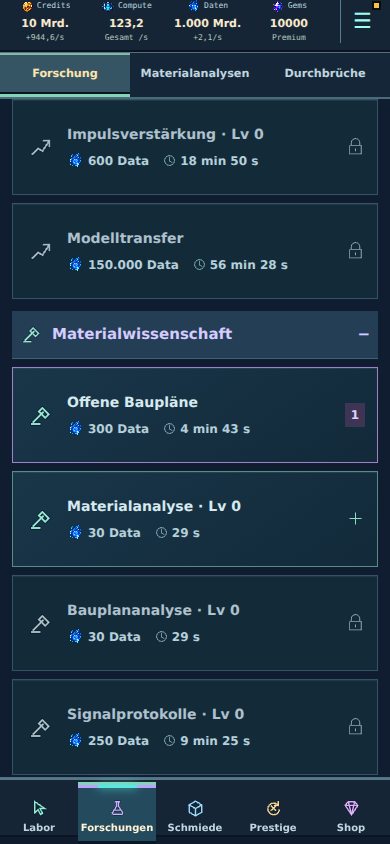
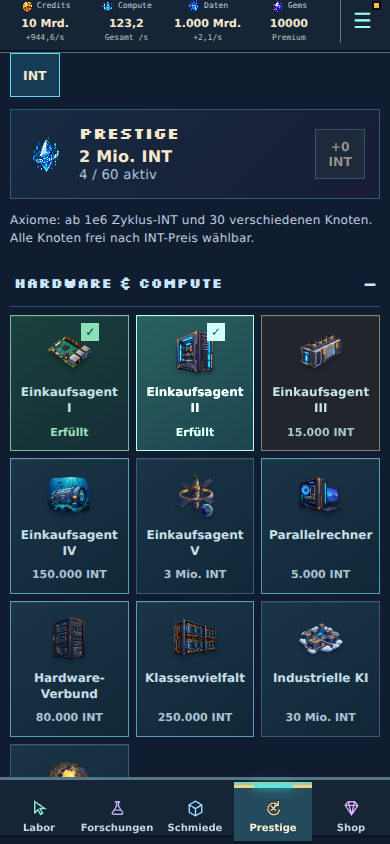
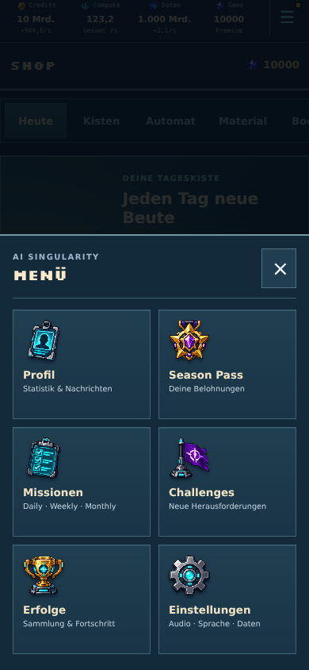
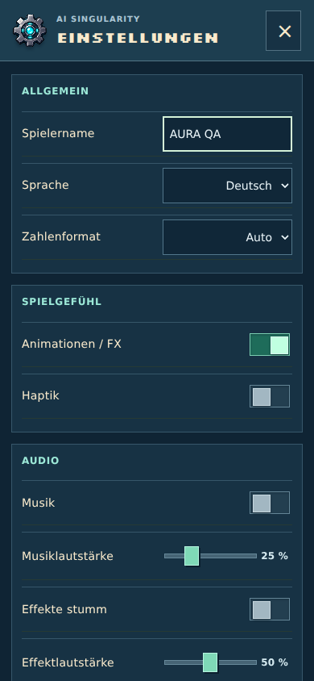
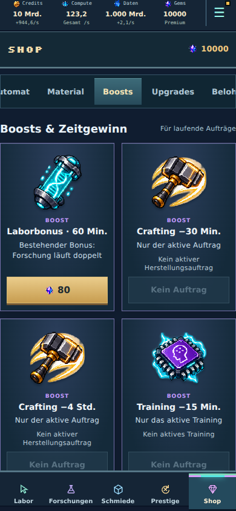

# Gemeinsame Spieloberfläche · Beta 7

Dieser Durchgang ergänzt die Item-Integration aus [Beta 6](cohesive-item-polish.md). Bestehende Anordnung, Navigation und Grafiken bleiben erhalten. Keine Economy-, Speicherformat- oder Freischaltungsänderungen.

## Ursachen und Änderungen

- Ein gemeinsamer Bitmap-Viewport zeigt jetzt die 30 Item-, 15 Hardware- und zwölf Shop-/Menü-Motive aus ihren unveränderten Originaldateien. Präzise Ausschnitte und Masken entfernen Nachbarfragmente; die Proportionen bleiben erhalten. SVG dient nur als Ausschnitt für das vorhandene Bitmap.
- Forschung bleibt eine einspaltige Liste. Titel, Kosten und lesbare Dauer haben feste gemeinsame Abstände; Verfügbarkeit, laufende Aufträge und Queue-Positionen sind eindeutig. Konkurrierende alte Forschungsregeln wurden aus vier globalen Stylesheets entfernt. Der normale Forschungsbutton reiht bei belegten Laboren weiterhin automatisch ein.
- Prestige behält seine drei Spalten und bestehenden Abschnitte. Passende Originalmotive kennzeichnen die Fähigkeiten. Gekaufte Knoten behalten ihr Motiv mit einem kleinen Erledigt-Zeichen; Beschriftungen und Preise sind einheitlich angeordnet.
- Menü und Shop verwenden dieselben bereinigten Originalmotive. Die tägliche Kiste überlappt auf kleinen Geräten nicht mehr den Text. Drei Starterpaket-Items passen ohne Verzerrung in ihre Karte; Tabs und Angebotsreihenfolge bleiben erhalten.
- Einstellungen haben beschriftete native Checkboxen mit Switch-Rolle, sichtbarem Schaltzustand und 56 × 44 px Trefferfläche. Tastaturbedienung und reduzierte Bewegung bleiben erhalten.
- Allgemeine PixelIcon-Vektoren füllen ihre vorgegebene Iconfläche, statt darin nochmals zu schrumpfen.

## Abnahme

Node 22: Typecheck, Produktionsbuild sowie **1.651 Tests in 118 Dateien bestanden**. Der Build meldet weiterhin den vorhandenen Hinweis auf ein großes Hauptbundle.

Der reproduzierbare Browserlauf `scripts/surface-polish-audit.mjs` prüft 320 × 640 und 390 × 844 auf Deutsch sowie 430 × 932 auf Englisch: tatsächliches Einreihen einer Forschung, Knotenkauf, Shop-Tabs und Tastaturnavigation, sechs Menü-Motive, Switch-Bedienung und reduzierte Bewegung. Keine Seitenüberbreite oder Laufzeitfehler. [Messprotokoll](surface-polish-browser-results.json).

Der zusätzliche Lauf `scripts/cohesive-item-polish-audit.mjs` bestätigt weiterhin zentrierte Ausrüstung aller drei Familien ohne verschachtelte Rahmen, sofortige Herstellung/Fusion mit Ergebnisanimation, Season-Kisten sowie das zehnminütige Ausblenden des Gem-Angebots über einen Reload hinweg.

Die Prüfungen verwenden vorbereitete Spielstände. Natürliche Balance-Verläufe, echte iPhone-/WKWebView-Darstellung und Performance sowie native Store-/Werbeanbieter sind damit nicht abgenommen.

## Ansichten bei 390 px

