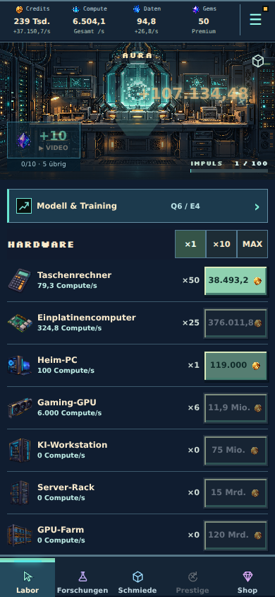
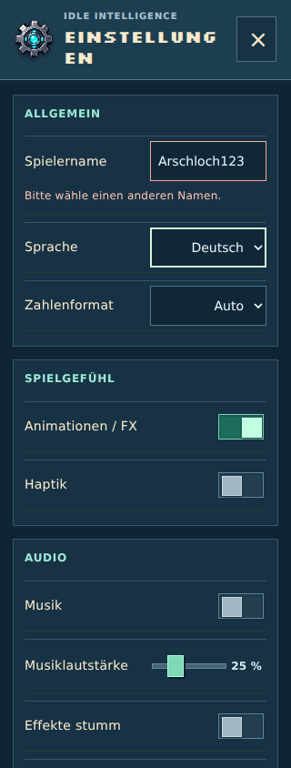

# Klickanzeige, Namensprüfung und Run-Analyse · Beta 8

## Ergebnis des hochgeladenen Berichts

Quelle: Export vom 18.10.2026, 19:50 UTC. [Abgeleitete Messwerte](taps-names-run-analysis.json); der persönliche ZIP-Export wird nicht ins Repository übernommen.

| Messwert | Beobachtung |
| --- | --- |
| Erfasster Run | 4 h 9 min 32 s, ein laufender Run, kein Prestige |
| Gewertete Taps | 570 |
| Gebuchte Tap-Credits | 840.269,22 |
| Passive Credits | 43.704.705,65 |
| Insgesamt verdiente Credits | 45.961.841,43 |
| Aktuelle Produktion | 40.568,60 Credits/s; 26,83 Daten/s |
| INT-Fortschritt | 0,2451 INT, noch keine ganze INT abholbar |
| Modell | Level 10, Qualität 6, Effizienz 4 |
| Fortschritt | 10 Trainings und 11 Forschungen abgeschlossen |
| Crafting | Alle zwölf protokollierten Jobs begannen und endeten im selben Zeitstempel |

Die Aussage „Taps zahlen grundsätzlich nichts“ wird von den Messwerten nicht bestätigt. Ihr Anteil am gesamten verdienten Einkommen beträgt hier rund 1,83 %. Daraus allein lässt sich keine allgemeine Stärke des aktiven Spielens ableiten: In vielen Messfenstern gab es keine Taps.

Der Anzeigefehler ist im aktuellen Code reproduzierbar: Das Popup las nach einem erfolgreichen Tap den nächsten Tap-Quote. Während der 200-ms-Eingabesicherung ist dieser Quote null. Außerdem konnte sich das Popup durch nachfolgende Quotes ändern, statt den bereits gebuchten kritischen Treffer oder Relay-Bonus darzustellen.

## Korrektur

`settleTap` gibt neben dem Zustand einen Beleg über den tatsächlich hinzugefügten exakten Run-Creditbetrag zurück. Die Oberfläche animiert nur bestätigte Taps und behält deren Betrag. Abgewiesene Eingaben erzeugen keinen neuen Beleg und verbrauchen keinen Platz im zusätzlichen Fünf-Taps-pro-Sekunde-Limit. Die zugängliche Vorschau berechnet den nächsten zulässigen Zeitpunkt statt eine Eingabesicherung als Null-Ertrag auszugeben. Krits, Relay, Mindestbetrag, Combo, Tagesökonomie und bestehende Tapsperren bleiben unverändert; keine Balance-Konstanten angepasst.

Neue Exporte enthalten `buildVersion` in Zusammenfassung und Manifest sowie den vollständigen Buildnamen in den Diagnosen. `tapDiagnostics` trennt den aktuellen Eingabe-Quote, den nächsten zulässigen Quote und die Ursache einer Sperre. Quotes sind Vorschauen; die tatsächliche Tap-Auszahlung steht weiterhin in den Einkommensmessungen.

## Was das Balancing noch offenlässt

Bei 0,245 INT nach über vier erfassten Stunden ist das erste Prestige noch nicht erreicht. Die erste ganze INT benötigt ohne weitere INT-Modifikatoren rund 765,1 Mio. berechtigte Credits. Bei unveränderter Endproduktion fehlen rechnerisch noch knapp 4 h 55 min; zusätzliche Hardware, Training und Forschung machen diese reine Momentaufnahme ausdrücklich zu keiner Spielzeitprognose. Ein weiterer natürlicher Run bis mindestens zum ersten und zweiten Prestige ist nötig, bevor die Reset-Skalierung bewertet werden kann.

Nachprüfung in Beta 9: Die aufgeführten Millionenpreise späterer Projekte stammten aus einer Legacy-Exportfunktion und waren nicht die tatsächlichen V2-Angebote. Diese Werte sind deshalb kein Beleg für eine entsprechende aktuelle Forschungswall. Der Export ist korrigiert; die anschließend ausdrücklich beauftragte frühe Progression wurde separat kalibriert. [Korrektur und neue Messung](early-balance-rework.md).

375 detaillierte Snapshots wurden durch das Limit verworfen. Es gibt keine erfassten Savefehler oder nichtendlichen Zahlen, aber zwei Watchdog-Ereignisse. `lastSuccessfulSave = null` und fehlende Savegrößen sind eine Diagnose-Lücke, kein Nachweis eines fehlgeschlagenen Speicherns. Der Bericht enthält keinen vollständigen Spielstand; die Browserprüfung verwendet einen separat aufgebauten Zustand mit denselben wesentlichen Produktionsstufen.

## Gemeinsame Namensprüfung

Spielername und KI-Name verwenden `namePolicy.ts`. Die Prüfung normalisiert Unicode, Groß-/Kleinschreibung, Akzente und häufige Zahl-/Buchstaben-Ersetzungen; sie berücksichtigt getrennte Schreibweisen und häufige visuell ähnliche Zeichen. Enthalten sind verbreitete Beleidigungen, Schimpfwörter und Hassbegriffe in den sieben unterstützten Sprachräumen. Kurze Wörter werden nicht pauschal in beliebigen Namen gesucht: beispielsweise bleiben „Scunthorpe“, „Cassian“, „Spice“ und „Yoshito“ zulässig.

Spielername: 2–24 Zeichen. KI-Name: 2–20 Zeichen. Buchstaben, Zahlen, kombinierende Schriftzeichen, Leerzeichen, Bindestrich und Unterstrich sind erlaubt. Reine Trennernamen, unsichtbare Formatzeichen und andere Sonderzeichen werden abgewiesen. Eine neutrale Fehlermeldung erscheint am Eingabefeld. Spielername wird erst bei Enter oder Verlassen des Felds übernommen; ein ungültiger Entwurf ersetzt den bisherigen Namen nicht. Beide Spielaktionen validieren zusätzlich selbst.

Dies ist ein lokaler Vorfilter, keine vollständige Sprachmoderation. Vor künftigen Leaderboards oder Clans muss derselbe Vertrag am Server gelten, einschließlich importierter/alter Namen und serverseitiger Moderation. Bestehende lokale Spielstände werden wegen eines Namens weder verworfen noch automatisch umbenannt. Noch keine Online-Schnittstelle hinzugefügt.

## Abnahme

- Typecheck und Produktionsbuild unter Node 22 bestanden; vorhandener Hinweis zum großen Hauptbundle bleibt bestehen.
- Gezielte Prüfungen: 109 Tests in sechs Dateien bestanden, einschließlich exakter Tap-Belege, Cooldown/Challenge-Sperre, kritischem Treffer/Relay, großem Zahlenbereich, Namensumgehungen, normalen internationalen Namen und Berichtdiagnostik.
- Vollständiger Testlauf: **1.702 Tests in 121 Dateien bestanden**. Anschließend wurden drei weitere Namensfälle ergänzt und die betreffenden sechs Dateien erneut mit insgesamt 109 erfolgreichen Tests geprüft.
- Browser bei 320/390/430 px: tatsächliche positive Tap-Anzeige, kein neues Popup für abgewiesene Eingabe, Name abweisen/normalisiert übernehmen; bei 320 px zusätzlich KI-Benennung mit verbotenem und anschließend zulässigem Namen. Keine Seitenüberbreite oder Laufzeitfehler. [Protokoll](taps-names-browser-results.json); reproduzierbar mit `scripts/taps-names-audit.mjs`.
- Kein Xcode-/WKWebView-Gerätecheck in dieser Umgebung.

