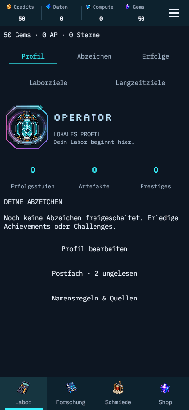

# Lebendige Farbanimation · 2026-11-03

Der Profilrahmen wechselt sichtbar zwischen Cyan, Violett und Pink. Zwei gegenläufige Energiebögen und vier Lichtpunkte umkreisen den Core. Der Core pulsiert sanft; Grafik und Profilname nehmen einen Teil der aktuellen Lichtfarbe auf. Auch die gemeinsamen Konturen erhalten den fließenden Farbverlauf.

Die Bewegung folgt verstrichener Zeit und wird auf 30 Aktualisierungen pro Sekunde und sechs sichtbare Effekte begrenzt. Reduzierte Bewegung zeigt eine statische Kontur und setzt Skalierung/Farbtönung zurück. Effekte blockieren keine Touchziele; keine neuen Texturen, Materialien oder Partikelobjekte. Balance und Speicherschema bleiben unverändert.

## Prüfung

- 6/6 gezielte PlayMode-Tests (ReleasePresentationTests und WorkshopTests) bestanden. Prüfen Farb-/Zeitfortschritt, unveränderten Spielzustand, reduzierte Bewegung, deaktivierte Effekte, wiederholten Aufbau und Bedienbarkeit.
- Profilaufnahmen in DE/EN bei 320, 390 und 430 Pixeln; finale Aufnahme visuell geprüft. GIF aus 29 echten Unity-Frames mit Aufnahmezeitabständen erzeugt.
- Aktueller lokaler macOS-Build erfolgreich: 250.622.039 Bytes. Kein mobiler Gerätebuild für diesen Animationsnachtrag.
- Historische umfassendere Prüfungen stehen separat in [release-polish.md](release-polish.md); sie wurden für diesen rein visuellen Nachtrag nicht vollständig wiederholt.
- npm-Prüfungen sind im Unity-only-Projekt ohne package.json nicht verfügbar.

[Maschinenlesbarer Nachweis](vivid-animation.verification.json)
